# Dungeon Master loop

## Overview

Running a game well is two disciplines that feed each other. World-building sets the
initial conditions. Session prep turns the current world state into a session that is fun to
run. What happens at the table changes the world, which changes the next prep. This skill is
the loop that keeps the two in constant communication, built the way `development-loop` and
`writing-nonfiction` are built: a phased workflow with gates, calling a focused sub-skill at
each phase, and passing named artifacts forward.

The goal is a world you know well enough to improvise in. Set the initial conditions (world,
central pressure, where the characters land, a roster of NPCs and villains, factions, gods),
and the rest unfolds like a physics engine: each session is one step of the simulation, the
recap updates the state, and you run the next step.

This is a methodology, not a setting. It never invents a specific campaign world. It tells you
how to build and run one.

## The two directions and the artifact contract

Everything the sub-skills produce and consume is a named artifact. The contract is abstract
here so the method works at any table or tool. For a worked example that maps every artifact 1:1
to folders in an Obsidian vault, see `references/vault-binding.md`.

| Artifact | Produced by | Consumed by |
| --- | --- | --- |
| Setting canon (regions, settlements, factions, pantheon, lore) | worldbuilding-initial-conditions | session-prep, advancing-the-world |
| The Front (central pressure, the villain plan that advances if unopposed) | worldbuilding-initial-conditions | session-prep, advancing-the-world |
| Faction clocks | worldbuilding-initial-conditions | session-prep, advancing-the-world |
| Secrets and clues | worldbuilding-initial-conditions, session-prep | session-prep, advancing-the-world |
| Hooks and seeds (the iceberg of named-but-unbuilt things) | worldbuilding-initial-conditions, advancing-the-world | session-prep, worldbuilding-initial-conditions |
| Party roster (size, classes, roles, per-character levels, bonds, wants) | session-zero, party-composition | every prep and combat skill |
| Table safety (lines, veils, tone) | session-zero | worldbuilding-initial-conditions, session-prep, encounter-design, improvised-combat, custom-monsters |
| Session plan (strong start, scenes, secrets in play, NPCs, rewards, prep inventions) | session-prep | encounter-design, improvised-combat, advancing-the-world, play |
| Encounter (statblock refs, map, terrain, objective, tactics) | encounter-design, improvised-combat | printable-minis-and-terrain, play |
| Bestiary statblock (custom monster or villain) | custom-monsters | encounter-design, improvised-combat |
| Mini and terrain inventory (what you physically own) | printable-minis-and-terrain | improvised-combat, encounter-design |
| Print manifest (what to print, by when) | printable-minis-and-terrain (reads the Front, clocks, and cast for a multi-session lookahead) | you, ahead of the session |
| Session recap (what happened, loose ends, surviving villains, inventions made at the table) | advancing-the-world (guided capture) | advancing-the-world, next session-prep |

### Data flow

```dot
digraph dm_loop {
  rankdir=LR;
  node [shape=box];

  world [label="WORLD\ncanon, Front, clocks,\nsecrets, hooks"];
  roster [label="PARTY ROSTER\n(session-zero,\nparty-composition)"];
  prep [label="SESSION PREP\n(session plan,\nnon-combat challenges)"];
  combat [label="COMBAT\n(encounter-design,\nimprovised-combat)"];
  print [label="PRINT + MINIS\n(manifest, inventory)"];
  play [label="PLAY\n(run the session)"];
  advance [label="ADVANCING\nTHE WORLD\n(recap, tick clocks,\ngrow Front)"];

  world -> prep [label="world to session"];
  roster -> prep;
  prep -> combat;
  combat -> print;
  combat -> play;
  print -> play;
  play -> advance [label="recap + loose ends"];
  advance -> world [label="session to world"];

  // The cast, clocks, and Front feed the print manifest ahead of any one
  // session, because print lead time runs days out.
  world -> print [label="cast, clocks, Front\n(multi-session lookahead)", constraint=false];

  // Prep-time write-back: anything invented during prep or improvised at the
  // table is promoted into canon, not left in the session note.
  prep -> world [label="prep-time write-back", style=dashed, constraint=false];
  play -> world [label="table improv write-back", style=dashed, constraint=false];
}
```

The dashed edges are the point most loops miss. Prepping a session, or improvising at the
table, often invents a new NPC, location, secret, or monster. That invention is promoted into
canon through a named step (see session-prep and advancing-the-world), never left stranded in
one session's notes. The world updates both after play and during prep.

## The loop, in order

Run the phases in order. Each gate passes before the next phase starts. Violating the letter of
this is violating the spirit of it. A sub-skill is invoked, not merely named: use the skill
loader the runtime provides, or read the named SKILL.md when there is no loader.

**Phase 1, World premise (first pass).** Invoke `worldbuilding-initial-conditions`, premise
pass only: enough world, central pressure, and tone to pitch at session zero. Do not finalize
NPC rosters or the party's landing position yet.
Gate: a one-paragraph premise and the central pressure exist.

**Phase 2, Session zero.** Invoke `session-zero`. Safety tools, table expectations, and each
character's bonds and wants.
Gate: safety tools agreed; every player character has at least one bond and one want recorded.

**Phase 3, Party composition.** Invoke `party-composition`. Capture the roster and derive the
downstream drivers (encounter baseline, tactical gaps, spotlight needs).
Gate: a party roster artifact exists with size, levels, roles, and derived drivers.

**Phase 4, Finalize initial conditions (second pass).** Return to
`worldbuilding-initial-conditions`, finalize pass: the landing position (where and how play
starts), and NPC and villain ties to the bonds and wants from phases 2 and 3.
Once the villains and recurring NPCs are named, invoke `printable-minis-and-terrain` to queue
their minis now. Print lead time runs ahead of any single session, so the cast is the earliest
thing you can commit to a plate.
Gate (matches the worldbuilding-initial-conditions finalize gate): landing position set; at least
one villain or NPC tied to a player character; every faction has a clock; roughly ten secrets
exist.

**Phase 5, Session prep.** Invoke `session-prep`. Pull the world forward into a runnable
session plan with combat and non-combat challenges. Invoke `encounter-design` for planned
fights and `custom-monsters` when a fight needs a monster the books lack.
Gate: a session plan exists with a strong start, secrets in play, and at least one designed
challenge.

**Phase 6, Physical prep (optional, lead-time gated).** Invoke `printable-minis-and-terrain`.
Reconcile this session's plan against the mini and terrain inventory and the lookahead already
seeded in Phases 4 and 8, and queue any remaining prints early enough to finish.
Gate: every enemy and key terrain piece has a plan (owned, printing, or proxied).

**Phase 7, Run.** Play. When you improvise a fight with no prepped encounter, invoke
`improvised-combat`. Record every invented NPC, location, secret, or monster in the recap's
inventions field for write-back.

**Phase 8, Advance the world.** Invoke `advancing-the-world`. Capture the recap, write prep-time
and table inventions into canon, tick clocks, roll unfound secrets forward, convert loose ends
to hooks, re-stat recurring villains, and advance the Front. With the clocks ticked and the Front
grown, invoke `printable-minis-and-terrain` again to queue the likely enemies the coming sessions
will need (a clock near filling, a re-statted villain), while there is still lead time.
Gate: the world artifacts reflect the session. The loop returns to Phase 5 for the next session.

## Routing shortcuts

You do not always start at Phase 1. Enter where the work is, and respect that phase's inputs.

- New campaign or one-shot: start at Phase 1.
- Prepping next week's session: Phase 5, after a quick check that Phase 8 ran for last session.
- A fight broke out with no prep: `improvised-combat` directly.
- The party roster changed: `party-composition`, then re-check encounter baselines.
- The session just ended: `advancing-the-world`.

## Red flags, stop

- You are prepping a session but have not run `advancing-the-world` for the previous one, so the
  world state is stale.
- You invented an NPC or location during prep or play and left it in the session note instead of
  promoting it to canon.
- You designed an encounter by XP alone, with no objective, terrain, or tactics.
- You are deciding what happens in the session instead of what is true in the world. Prep the
  situation, not the plot.
